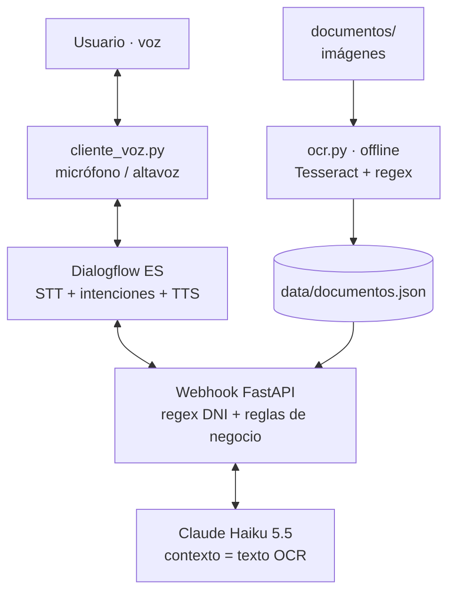

# Clínica Veterinaria Patitas · Asistente de voz

## Caso de uso

Asistente telefónico por voz de una clínica veterinaria. El cliente puede **pedir cita**
(servicio, especie, día, hora y DNI): el agente valida los datos, le dice el precio y pide
confirmación antes de reservar. También puede **preguntar dudas** sobre las tarifas y
condiciones de la clínica o sobre los prospectos de tres antiparasitarios habituales
(Milbemax, Frontline Combo y Seresto). Esas respuestas salen únicamente de documentos
procesados con OCR, y si la información no está en ellos el asistente lo dice en lugar
de inventarla.

## Arquitectura



## Intenciones

| Intención | Propósito | Webhook |
| --- | --- | --- |
| `Default Welcome Intent` | Saludo y presentación de lo que sabe hacer | No |
| `pedir_cita` | Recoge servicio, especie, fecha, hora y DNI (slot filling). Activa `ctx_solicitud_en_curso` | Sí: valida los datos y calcula el precio |
| `pedir_cita - si` | Follow-up de confirmación. Genera el código de referencia | Sí |
| `pedir_cita - no` | Follow-up de cancelación. Cierra el contexto | No |
| `consulta_documental` | Preguntas sobre tarifas, horario y prospectos | Sí: LLM sobre el texto OCR |
| `despedida` | Cierra la conversación | No |
| `transferir_humano` | Pasa con una persona del equipo *(mejora opcional, simulada con un mensaje)* | No |
| `Default Fallback Intent` | Lo no reconocido se intenta resolver con los documentos | Sí: LLM |

**Entidades**

- `@dni` (regex): `(?:\d[\s.]?){8}-?\s?[A-Za-z]`. Admite espacios o puntos entre cualquier dígito, porque el STT dicta "7749 7777 m".
- `@especie` y `@servicio` (personalizadas, con sinónimos).
- `@sys.date` y `@sys.time` (sistema).

**Contexto**: un único flujo con `ctx_solicitud_en_curso`. Lo abre `pedir_cita` y lo cierran `pedir_cita - si` y `pedir_cita - no`.

## Decisiones técnicas

- **Validación en el webhook** (`webhook/citas.py`). Se valida que el servicio tenga tarifa, el DNI con regex y letra de control (módulo 23), que la fecha sea futura y que caiga en horario de apertura. El precio depende del servicio. Se valida al final del slot filling y no en cada turno, por simplicidad.
- **Horas ambiguas.** Dialogflow resuelve "a las 10:30" como la próxima 10:30, que por la noche es 22:30. Si la hora cae fuera del horario de la clínica, el webhook toma la del otro tramo de 12 h (22:30 → 10:30). El resumen repite la hora, así que el usuario puede corregirla.
- **Corrección de un dato inválido sin repetir el resto.** Cada parámetro de `pedir_cita` tiene como valor por defecto `#ctx_solicitud_en_curso.<parámetro>`. Si el DNI es incorrecto y el usuario lo repite, los demás datos se recuperan del contexto.
- **OCR offline** (`ocr.py`). Se ejecuta una vez y guarda `data/documentos.json`; el webhook solo lee ese fichero, porque Dialogflow corta a los 5 s.
  - Los prospectos de CIMAVet (Milbemax, Frontline Combo y Seresto) se descargaron en PDF y se convirtieron a imagen una sola vez con PyMuPDF (200 dpi, gris), para que lo que entra al OCR sean imágenes y no texto ya digital. Los PDF originales están en `documentos/pdf_originales/`.
  - La hoja de tarifas es de la clínica ficticia: se generó como imagen simulando un escaneo (ruido, ligera rotación y desenfoque).
  - Preprocesado: escala de grises y autocontraste.
  - `--psm 6` (un bloque de texto): con el modo por defecto, la columna de precios de las tarifas salía separada de su servicio.
  - Regex sobre el texto reconocido: fechas `dd/mm/aaaa` y `mm/aaaa` (validadas con `strptime`), importes en euros y nº de registro AEMPS.
- **Sin base vectorial**: con 4 documentos cabe todo el texto en el prompt (*context stuffing*), y se descartó la Knowledge Base de Dialogflow porque no permite controlar el prompt ni las alucinaciones.
- **Control de alucinaciones**: el prompt obliga a responder solo con los documentos y, si no está la respuesta, a devolver la marca `NO_ENCONTRADO`. Es **nuestro código** el que la convierte en "esa información no aparece en los documentos". El prompt permite además lo que se deduce directamente ("domingos: cerrado" responde a "¿abrís los domingos?").
- **LLM: Claude Haiku 5.5** (API de Anthropic, esfuerzo `low`): el modelo más rápido de Claude, adecuado para respuestas cortas sobre un texto dado. No admite *structured outputs*, por eso el "no lo sé" es una marca de texto (`NO_ENCONTRADO`) que comprueba nuestro código. Antes se probó Gemini, pero su nivel gratuito estaba saturado (6–250 s por respuesta y errores 503), incompatible con el límite de 5 s de Dialogflow; OpenAI se descartó por no tener saldo en la cuenta.
- **Latencia < 5 s**: el webhook responde en 0,8–3,2 s cuando consulta el LLM y en milisegundos en el flujo de citas. Timeout de 4 s sin reintentos y `try/except`. Respuestas de máximo ~30 palabras, para que la síntesis de voz también sea rápida. Instrucciones y documentos van fijos al principio del prompt y se marcan con `cache_control` para aprovechar la caché de prompts. Si el modelo falla o tarda, se responde un mensaje de disculpa en vez de silencio.
- **Voz**: STT y TTS nativos de Dialogflow (modo audio de `detect_intent`). El cliente graba 7 s por turno: con 5 s no daba tiempo a dictar un DNI. Todas las respuestas van en **SSML** (`<break>`, `<say-as>` para precios y para deletrear el código de referencia).
- **Razonamiento del modelo**: se mantiene el razonamiento adaptativo con esfuerzo `low`. Se probó a desactivarlo: la latencia bajaba (máx. 2,4 s), pero fallaba en preguntas que obligan a buscar dentro de los prospectos largos. Con `low` la evaluación da 14/14 con latencia máxima de 3,2 s.

## Estructura

```
clinica-vet-bot/
├── cliente_voz.py          # cliente de voz (micrófono <-> Dialogflow)
├── ocr.py                  # OCR offline -> data/documentos.json
├── data/documentos.json    # texto OCR + campos extraídos con regex
├── documentos/             # imágenes de entrada (y PDF originales de CIMAVet)
├── dialogflow/
│   ├── ClinicaVetPatitas.zip   # export del agente (importar en Dialogflow)
│   └── agente/                 # el mismo export descomprimido
├── webhook/
│   ├── main.py            # capa HTTP (FastAPI) y logging
│   ├── modelos.py         # contrato de Dialogflow validado con Pydantic
│   ├── intenciones.py     # un manejador por intención -> SSML
│   ├── citas.py           # dominio: DNI, horario y tarifas (sin FastAPI ni Dialogflow)
│   ├── documentos.py      # consulta documental con Claude
│   └── prompts/           # prompts versionados como código
├── evals/                 # casos reales y script de evaluación del LLM
└── tests/                 # tests unitarios (sin red ni coste)
```

## Cómo ejecutarlo

Requisitos:

- [uv](https://docs.astral.sh/uv/) (instala Python 3.12 y las dependencias de `uv.lock`).
- Tesseract con el idioma español (instalador de UB Mannheim, marcando *Spanish*).
- Un agente de Dialogflow ES y una cuenta de servicio de Google Cloud con el rol *Dialogflow API Client*.
- Una API key de Anthropic.

```bash
uv sync
cp .env.example .env        # y rellenar las claves
```

1. **OCR** (solo una vez, o si cambian los documentos): `uv run ocr.py`
2. **Webhook**: `uv run uvicorn webhook.main:app --port 8000`
3. **Exponerlo**: en VS Code, pestaña *PORTS* → reenviar el 8000 → *Port Visibility: Public*.
   Comprobar que la URL pública responde `{"estado": "ok"}`. El webhook tiene que seguir corriendo:
   el reenvío de puertos sigue activo aunque el servidor esté parado, y entonces Dialogflow da `URL_TIMEOUT`.
4. **Agente**: en Dialogflow ES → ⚙️ → *Export and Import* → *Restore from ZIP* con
   `dialogflow/ClinicaVetPatitas.zip`. Después:
   - En *Fulfillment*, pegar la URL pública acabada en `/webhook`.
   - En ⚙️ → *Speech*, activar *Enable Automatic Text to Speech* (voz *Automatic*).
5. **Voz**: `uv run cliente_voz.py` (necesita la clave JSON de una cuenta de servicio con
   el rol *Dialogflow API Client*, indicada en el `.env`).

## Calidad y buenas prácticas

```bash
uv run pytest                  # tests unitarios (31): dominio, webhook, LLM simulado y OCR
uv run ruff check .            # linting
uv run ruff format .           # formato
uv run mypy                    # tipos
uv run python -m evals.evaluar # evaluación del LLM real con evals/casos.json (cuesta céntimos)
```

**Aplicadas**

- **KISS / YAGNI**: un único endpoint (`POST /webhook`, que es lo que Dialogflow llama), sin base de datos ni base vectorial.
- **Separación de responsabilidades**: HTTP, contrato, intenciones, dominio y LLM en módulos distintos. El dominio (`citas.py`) no conoce FastAPI ni Dialogflow.
- **Fallar rápido**: los parámetros de la cita se validan con Pydantic (`ParametrosCita`); si falta uno o llega mal formado, falla al entrar y no a mitad.
- **Defensa en profundidad**: si un manejador falla, el webhook responde una frase amable en vez de un 500. Si el LLM falla o tarda, se disculpa. Todo texto variable se escapa antes de meterlo en el SSML.
- **Entrada no confiable**: la pregunta va entre etiquetas `<pregunta>` y el prompt indica tratarla como dato. La evaluación incluye un intento de *prompt injection*.
- **Prompts versionados como código** (`webhook/prompts/`) y **evaluación con casos reales** (`evals/`): 14 preguntas, incluidas las que no deben contestarse. Con ella se detectó una regresión ("¿abrís los domingos?") y se descartó desactivar el razonamiento.
- **Logging, no `print`**, en el webhook: intención y latencia de cada petición. Los parámetros no se registran porque incluyen el DNI. (`ocr.py`, `cliente_voz.py` y `evals/` son scripts de consola y escriben en pantalla.)
- **Secretos fuera del código**: claves en `.env` (ignorado por git). Del export del agente se quitó la `secondaryKey`. La cuenta de servicio solo tiene el rol *Dialogflow API Client* (mínimo privilegio).
- **Dependencias fijadas**: `uv.lock` y `.python-version`.
- **Tipado** en todo lo público, comprobado con mypy, y tipos del SDK de Anthropic (`TextBlockParam`) en vez de diccionarios sueltos.
